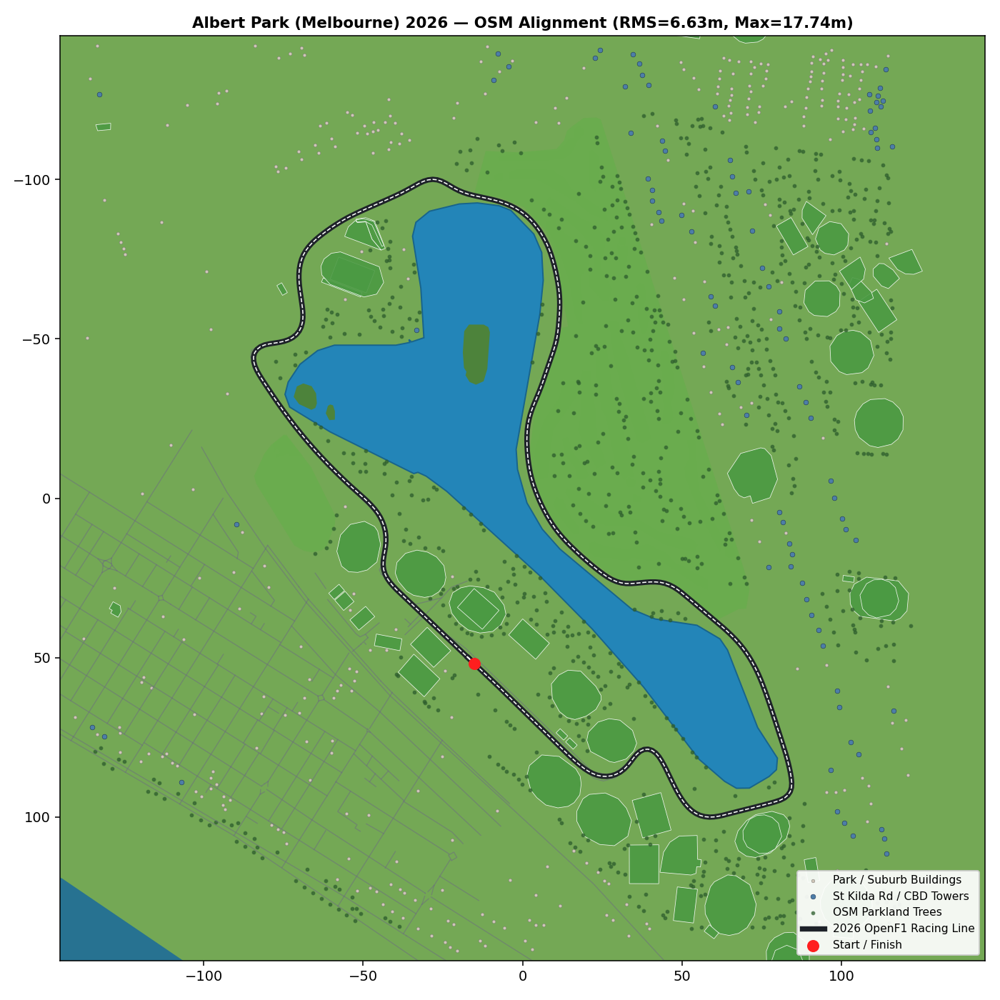
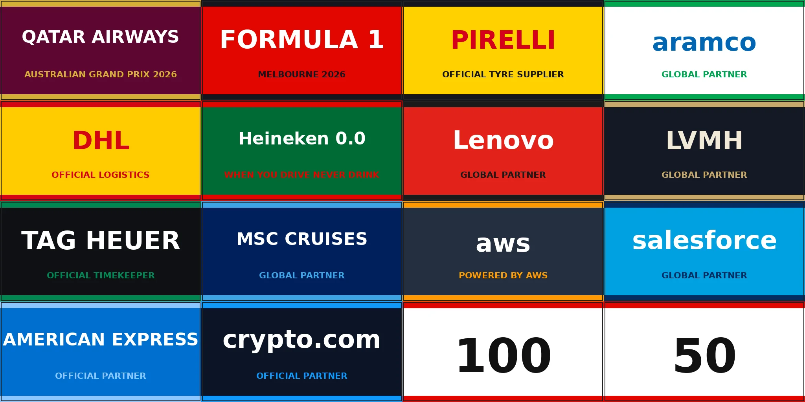
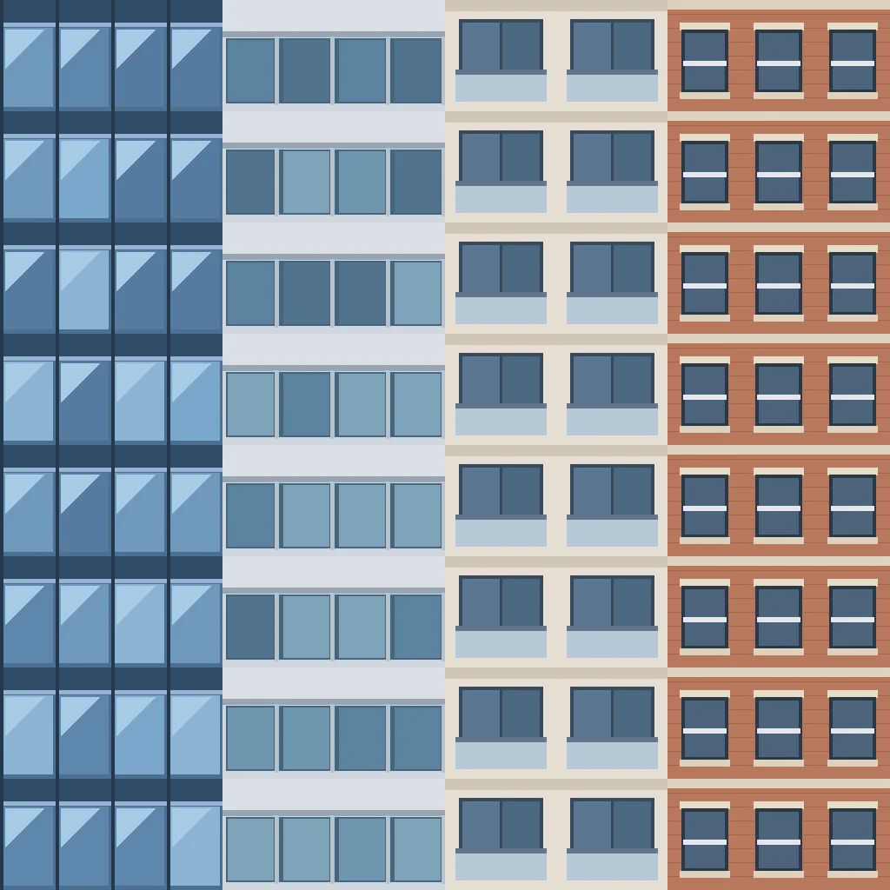

# Albert Park (Melbourne) 2026 — Verification & Comparison

## 1. OSM-to-Telemetry Alignment Overview

- **Alignment Fit** (`scripts/circuits/build_albert_park.py` aligning 31 OSM Albert Park Circuit ways / 589 sampled points to `public/data/2026/races/melbourne.json`):
  - **Scale**: `0.115318` render units / metre (telemetry `upm = 0.112723`)
  - **Rotation**: `0.06°` (true north along `-Z`, `northVec = [0.001, -1.0]`, `flipY = -1.0`)
  - **RMS Error**: **6.63 m** · **Max Error**: **17.74 m**

## 2. Close-Up Upgrade Assets (Logos & Building Facades)

### 2026 Official Partner Logo Atlas (`ads.webp` — 2048×1024, 98.3 KB)

- 13 official SVG logos fetched from Wikimedia Commons (`Qatar Airways`, `Formula 1`, `Pirelli`, `Saudi Aramco`, `DHL`, `Heineken`, `Lenovo`, `LVMH`, `TAG Heuer`, `MSC Cruises`, `AWS`, `Salesforce`, `American Express`) + clean text fallback for `Crypto.com` + FIA `100`/`50` braking markers.
- Rendered across barrier boards, start gantry, 3 footbridges, pit-building roof fascia, grandstand front fascia, and painted run-off decals in **1 draw call** with mipmaps (`LinearMipmapLinearFilter`) and `anisotropy = 8` (`4` in low).

### Melbourne Architectural Facade Atlas (`facades.webp` — 1024×1024, 30.3 KB)

- 4 vertical architectural styles tiled at real-world floor scale (**~3.4 m per floor**, never stretched): CBD blue-glass curtain wall, St Kilda Road silver/teal office ribbon windows, Albert Park cream render apartments with balconies, and Middle Park heritage brick terraces.
- Combined with baked vertical vertex ambient occlusion, roof parapets + HVAC plant boxes on offices/towers, pitched gable roofs on low residential houses, crowd-free architectural grandstands, and custom low-poly landmarks (**Albert Park Pit & Paddock**, **Race Control Tower**, **Lakeside Stadium**, **MSAC**, and **Melbourne CBD skyline silhouettes**).

## 3. Albert Park Lake Water Upgrade
- **Smoothed Shoreline**: 2-iteration Chaikin corner-cutting on OSM lake polygon + island holes removes jagged polygon edges, paired with a clean sandy/stone shoreline embankment strip.
- **Custom Lightweight GLSL Shader** (1 draw call, zero planar reflection passes):
  - Two crossed scrolling procedural wave-normal layers for wind ripples.
  - Baked per-vertex shore distance (`color.r`) transitioning from sunlit turquoise shallows (`#42b2c9`) to deep Melbourne blue (`#145a8a`) plus a subtle animated shoreline foam/shallows rim.
  - View-dependent Fresnel sky reflection (`#d2ebff`) and midday sun specular glints.
- **Lakeside Details**: Timber jetties and boatsheds along the northern, eastern, and western lake shores merged into the structures mesh (0 extra draw calls).

## 4. Before / After Performance Budgets

Verified by `src/components/track/tracks/melbourne/melbourneBuilders.test.ts` (`npm test` — 162/162 passing):

| Metric | Before (`106a578`) High | After (`d3f5c76`) High | High Limit | Before (`106a578`) Low | After (`d3f5c76`) Low | Low Limit |
| --- | --- | --- | --- | --- | --- | --- |
| **Asset Download** | 150.2 KB | **197.8 KB** | ≤ 3,072 KB | 66.2 KB | **86.7 KB** | ≤ 600 KB |
| **Triangles (Full Env)** | 236,426 | **258,589** | ≤ 800,000 | 95,102 | **109,197** | ≤ 250,000 |
| **Draw Calls (Full Env)** | 14 | **15** | ≤ 400 | 14 | **15** | ≤ 150 |
| **Lazy JS Chunk (gzip)** | 7.48 KB | **11.21 KB** | Lazy-loaded | 7.48 KB | **11.21 KB** | Lazy-loaded |

## 5. Local Visual Check Checklist
Headless SwiftShader WebGL in the cloud container did not exit cleanly after screenshot capture; inspect locally via `npm run dev` at `1440×900` and `390×844`:
- `/circuits` → Melbourne ("Inspect 3D"): aerial overview, pit straight close-up (Qatar Airways gantry/pit fascia, 11 garage bays, Race Control tower), T1/T3 crowd-free grandstands & sharp partner logos, lake shore close-up (smoothed edge, depth tint, Fresnel waves, jetties), and CBD skyline view looking north from T6.
- `/replay/melbourne?autoplay=1`: broadcast camera on pit straight & Lakeside Drive, top-down overview, zero console errors.
