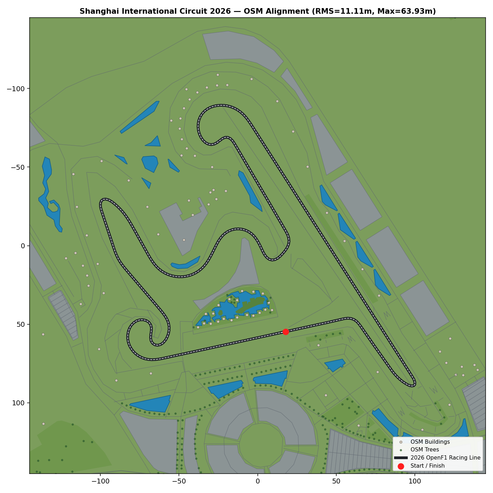

# Shanghai International Circuit (2026 Chinese GP) — Verification & Comparison

## 1. OSM-to-Telemetry Alignment Overview

- **Alignment Fit** (`scripts/circuits/build_shanghai.py` aligning OSM Relation `2094941` — 628 sampled points — to `public/data/2026/races/shanghai.json`):
  - **Scale**: `0.166832` render units / metre (telemetry `upm = 0.159958`)
  - **Rotation**: `0.39°` (true north along `-Z`, `flipY = -1.0`)
  - **RMS Error**: **11.11 m** · **Max Error**: **63.93 m** (reflecting the short-loop link inside the 4-way OSM circuit relation)
- **Key Features Verified on Alignment Map**:
  - **Paddock Lake & Islands** sit directly behind the pit building, aligned with the real OSM pavilion footprints.
  - **Main Fan Plaza** sits immediately south of Main Grandstand A.
  - **Back Straight (1.17 km)** aligns cleanly alongside the eastern retention ponds, car parks, and Jiading road grid.

## 2. Shared Realism Upgrades (Shanghai + Melbourne)
- **2026 Partner Logo Atlas**: `public/models/circuits/shanghai/ads.webp` (`2048×1024`, 98.3 KB high / 40.7 KB low) featuring **Heineken** as 2026 Chinese GP title sponsor on the start gantry, twin wing bridges, pit roof fascia, Main Grandstand A, and T14 hairpin — **1 draw call** with mipmaps and anisotropic filtering.
- **Architectural Facades & Custom Landmarks**: `facades.webp` (`1024×1024`, 30.3 KB high / 15.6 KB low) with ~3.4 m/floor real-metre UVs, baked vertical vertex AO, parapets/HVAC/pitched roofs, crowd-free grandstands, plus custom low-poly **Main Grandstand A** (sweeping canopy + tension masts), **Twin Elevated Wing Bridges**, **Pit Building + Race Control Tower**, and **Yuyuan-Garden-inspired Paddock Team Pavilions**.
- **Fresnel Animated Water Shader**: Shared `createDaytimeWaterMaterial` + Chaikin-smoothed shorelines on all 25 OSM water bodies (Paddock Lake, retention ponds, Jiading canals) with turquoise-to-deep-blue depth tint, crossed scrolling wave normals, sky Fresnel reflection, and midday sun glints (**1 draw call**).

## 3. Hard Performance Budgets (Shanghai & Melbourne Verified via `npm test` — 167/167 Passing)

| Circuit & Quality | Asset Download | Limit | Triangles | Limit | Draw Calls | Limit | Lazy JS Chunk (gzip) |
| --- | --- | --- | --- | --- | --- | --- | --- |
| **Shanghai (`high`)** | **165.2 KB** | ≤ 3,072 KB | **231,780** | ≤ 800,000 | **14** | ≤ 400 | **6.70 KB** |
| **Shanghai (`low`)** | **80.3 KB** | ≤ 600 KB | **104,307** | ≤ 250,000 | **14** | ≤ 150 | **6.70 KB** |
| **Melbourne (`high`)** | **197.8 KB** | ≤ 3,072 KB | **258,589** | ≤ 800,000 | **15** | ≤ 400 | **7.57 KB** |
| **Melbourne (`low`)** | **86.7 KB** | ≤ 600 KB | **109,197** | ≤ 250,000 | **15** | ≤ 150 | **7.57 KB** |

## 4. Local Visual Verification Checklist
Headless SwiftShader WebGL in the cloud container did not exit cleanly after live frame capture; inspect locally via `npm run dev` at `1440×900` and `390×844`:
- `/circuits` → Shanghai ("Inspect 3D"): aerial overview, pit straight + twin wing bridges + Main Grandstand A, T1–T2 snail grandstands, T14 hairpin (Grandstand K), and paddock lake + pavilions close-up.
- `/replay/shanghai?autoplay=1`: broadcast camera on pit straight & back straight, top-down overview, zero console errors.
- `/circuits` → Melbourne: verify refactor kept Albert Park identical with zero regressions.
